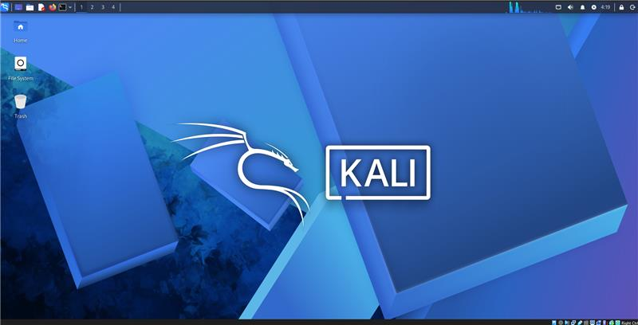
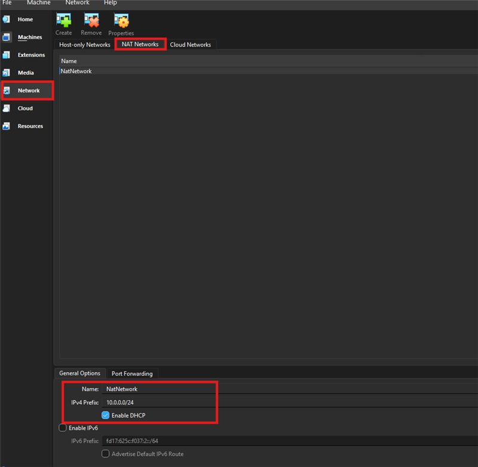
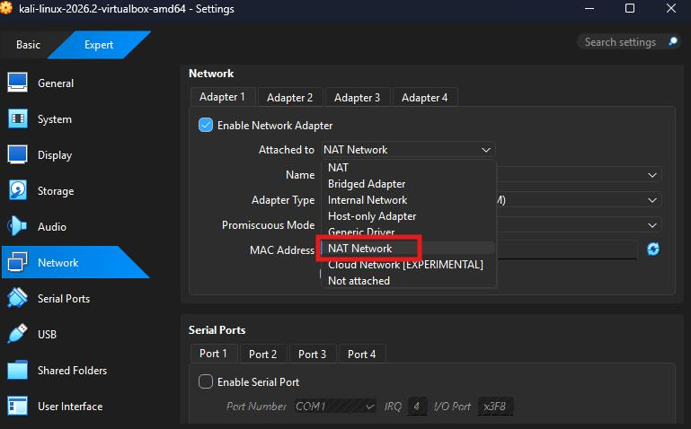
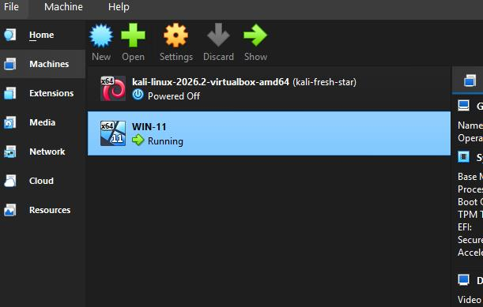
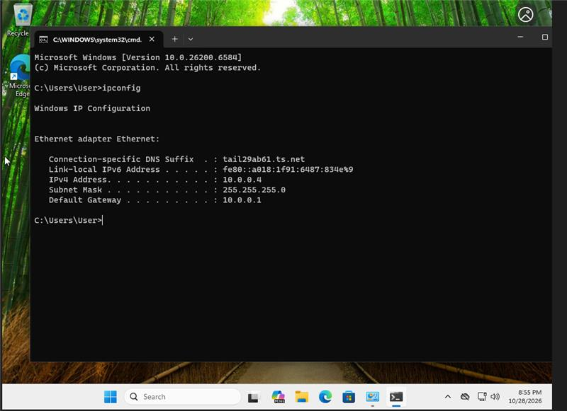
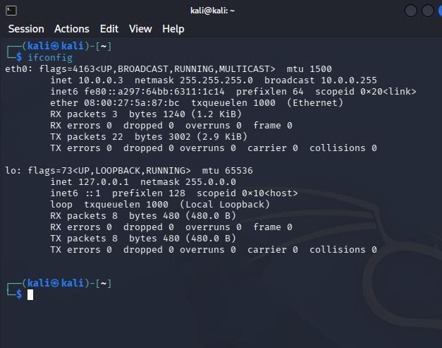

# 🔐 Cybersecurity Lab Environment Setup

### Building a virtual lab using VirtualBox, Windows 11 and Kali Linux

---

## 📌 Project Overview

This project demonstrates the setup of a virtual cybersecurity lab
using Oracle VirtualBox, Windows 11, and Kali Linux.

The lab is designed for learning virtualization, network configuration,
Linux fundamentals, and authorized cybersecurity testing.

## 🛠️ Tools Used

- Oracle VirtualBox
- Kali Linux
- Windows 11
- NAT networking
- Virtual machine network configuration

## 🖥️ Lab Setup Screenshots

### 1. Kali Linux Virtual Machine

### 2. NAT Network Configuration

### 3. NAT Network Settings

### 4. Windows 11 Virtual Machine

### 5. Windows IP Configuration

### 6. Kali Linux IP Configuration

## 🎯 Learning Objectives

- Understand virtualization and virtual machines.
- Configure NAT networking in VirtualBox.
- Learn basic Windows and Linux network troubleshooting.
- Practice cybersecurity in an authorized lab environment.

## ⚠️ Disclaimer

This lab is intended for educational purposes.
Only test systems you own or have explicit permission to assess.

## 👤 Author

Sophiya Tamang
